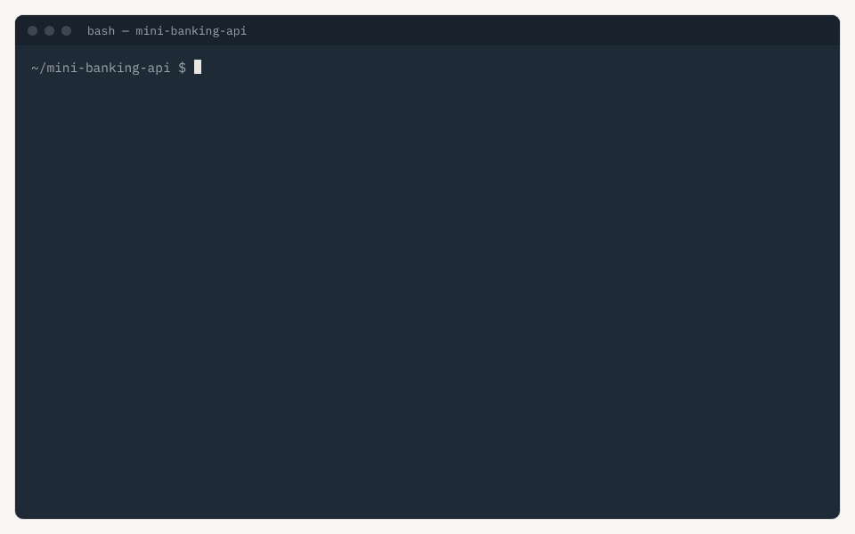
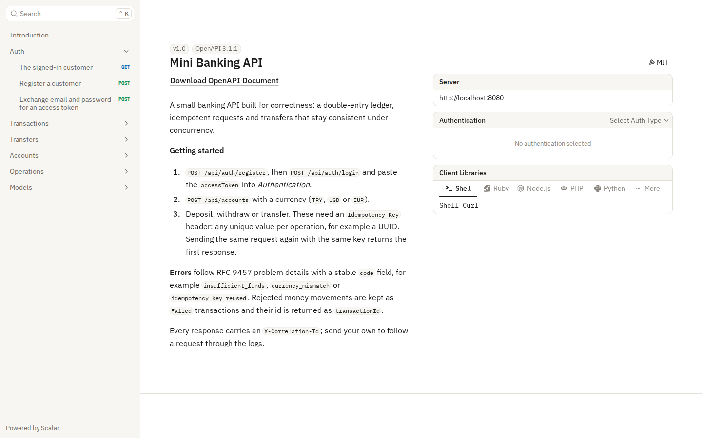
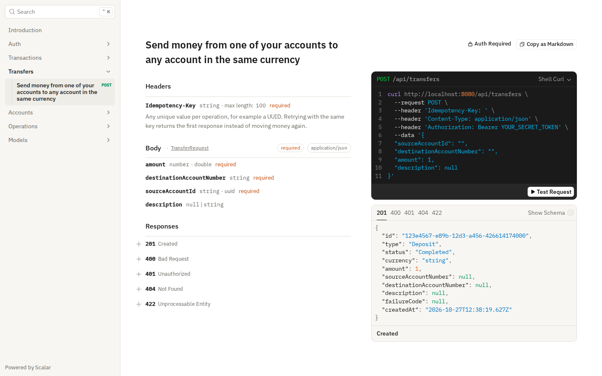
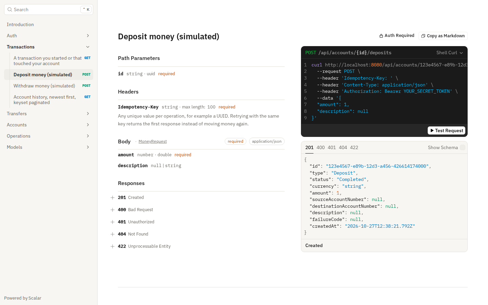
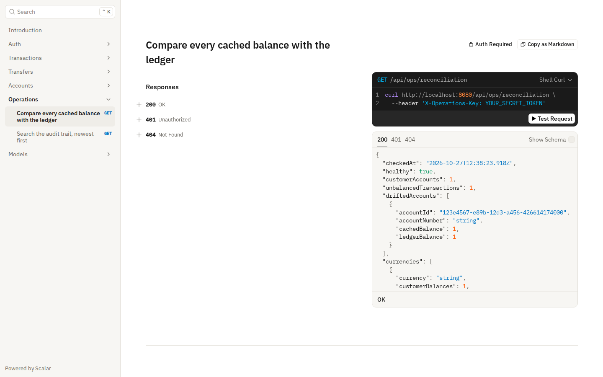
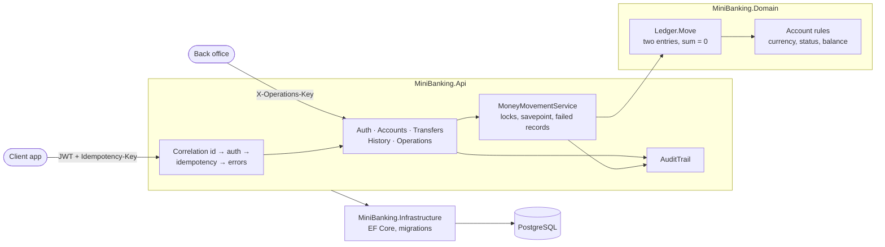
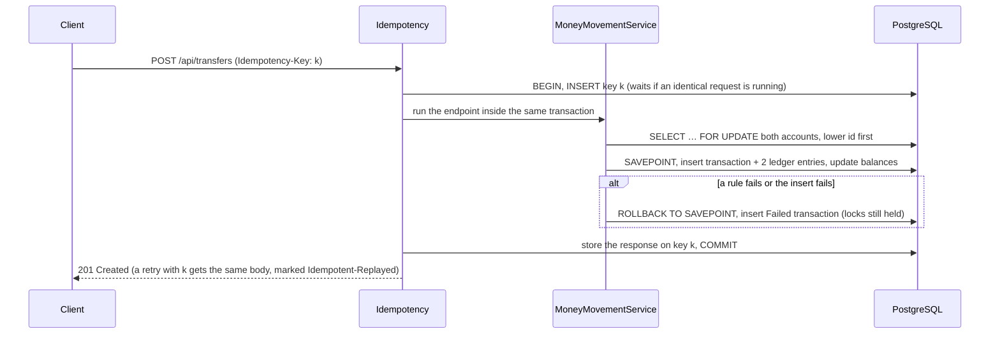

# Mini Banking API

**English** · [Türkçe](README.tr.md)

A banking API built around one promise: money never appears, disappears or moves twice — not under retries, not under concurrent requests, not when the database fails halfway.

[](https://github.com/Beratoguzhan620/mini-banking-api/actions/workflows/ci.yml)




## Try it

```bash
docker compose up --build
```

Open http://localhost:8080/scalar for the interactive API reference. To see the whole story from the terminal (needs `curl` and `jq`):

```bash
OPERATIONS_API_KEY=local-ops docker compose up --build -d
OPS_KEY=local-ops ./scripts/demo.sh
```

The script registers two customers, moves money between them, retries a request with the same idempotency key, fires 100 transfers at one account at the same moment and ends with the reconciliation report.

## Features

- **Customers:** registration and login with JWT. Passwords are hashed with PBKDF2; an unknown email and a wrong password get the same answer.
- **Accounts:**
  - One currency per account (TRY, USD, EUR); a customer can hold several.
  - Account numbers like `MB1234567890123456` with a Luhn check digit, so a mistyped destination is caught before it reaches the database.
  - Freeze (money can come in, not go out), unfreeze, close (only with a zero balance).
- **Money movements:** simulated deposits and withdrawals, transfers to any account number in the same currency. Insufficient funds, frozen or closed accounts and mixed currencies are refused, and the attempt is kept as a `Failed` transaction.
- **Double-entry ledger:** every movement writes two entries that add up to zero. Deposits and withdrawals are balanced against a per-currency system account.
- **Idempotency:** deposits, withdrawals and transfers require an `Idempotency-Key`. A retry replays the first response; the same key with a different request is refused.
- **History:** newest first, filtered by date and type, paged with an opaque cursor (keyset pagination, no `OFFSET`).
- **Audit trail:** registrations, logins (failed ones too), account changes and every money movement, with the actor and the request's correlation id. The table is append-only, enforced by a database trigger.
- **Operations endpoints:** a reconciliation report (cached balances vs. the ledger, per-currency positions) and audit search, behind a separate key and switched off unless configured.
- **Observability:** a correlation id on every response, error and log line; personal data and secrets are masked in logs.

## Screenshots

| API reference | Transfer endpoint |
|---|---|
|  |  |
| **Deposit with the idempotency header** | **Reconciliation report** |
|  |  |

## Tech stack

- ASP.NET Core 10 minimal APIs, ProblemDetails (RFC 9457), OpenAPI with Scalar
- Entity Framework Core 10 with PostgreSQL (Npgsql), snake_case naming, migrations
- JWT bearer authentication, ASP.NET Core Identity password hasher
- Serilog with structured logs, correlation ids and masking
- xUnit, Testcontainers (real PostgreSQL), WebApplicationFactory
- GitHub Actions: warnings as errors, unit and integration tests, pending-migration check, Docker Compose smoke test that moves money
- Docker / Docker Compose

## Architecture



A transfer, step by step:



## Design decisions

- **Money is a `long` in minor units.** No floating point and no rounding drift; sums in SQL are exact. The API speaks decimals with at most two places and converts at the edge.
- **Pessimistic locks, taken in id order.** A transfer locks both accounts with `SELECT … FOR UPDATE`, always the lower id first. A→B and B→A at the same time ask for the locks in the same order, so they queue instead of deadlocking. An `xmin` concurrency token protects the simpler updates (freeze, close).
- **The balance is cached, the ledger is the truth.** Reads are fast because the balance lives on the account row, and every entry stores the balance after it. The reconciliation endpoint and the tests check that the two always agree. The database also refuses a negative customer balance with a check constraint.
- **System accounts don't keep a cached balance.** Every deposit touches the currency's system account; updating its row would make it the hottest row in the database. Its position is derived from its ledger entries instead.
- **The idempotency key and the money are committed together.** The key row is inserted at the start of the same database transaction that moves the money. An identical request sent at the same moment waits on that row and then replays the stored response, so a crash can never leave money moved without its key, or a key without its money. Only rejected requests (400, 401, 404) give the key back.
- **Failed attempts are kept, under the same locks.** A rejected transfer rolls back to a savepoint and records a `Failed` transaction in the same database transaction. The first version wrote this record after a full rollback; the concurrency tests caught that it took locks in a different order and deadlocked under load.
- **Not found rather than forbidden.** Someone else's account answers 404, so account ids cannot be probed.
- **The audit trail is evidence.** Entries are written in the same unit of work as the change they describe, have no foreign keys (they outlive what they mention) and a trigger rejects any `UPDATE`, `DELETE` or `TRUNCATE`.
- **Operations behind their own key.** Reconciliation and audit search don't belong to customers. They use a separate key, compared in constant time, and answer 404 when no key is configured.

## Commands

| Command | What it does |
|---|---|
| `docker compose up --build` | API and PostgreSQL on http://localhost:8080 |
| `./scripts/demo.sh` | Guided tour against a running instance (`OPS_KEY` adds reconciliation) |
| `dotnet test` | Unit and integration tests (Docker needed for Testcontainers) |
| `dotnet run --project src/MiniBanking.Api` | Run locally (see configuration below) |
| `dotnet ef migrations add <Name> --project src/MiniBanking.Infrastructure --startup-project src/MiniBanking.Api --output-dir Persistence/Migrations` | Add a migration |

Configuration for a local run, kept out of the repository:

```bash
dotnet user-secrets --project src/MiniBanking.Api set "ConnectionStrings:Banking" "Host=localhost;Database=mini_banking;Username=…;Password=…"
dotnet user-secrets --project src/MiniBanking.Api set "Jwt:SigningKey" "<at least 32 characters>"
dotnet user-secrets --project src/MiniBanking.Api set "Operations:ApiKey" "<optional>"
```

## Tests

98 tests: 28 unit tests for the domain rules and 70 integration tests that run the real API against PostgreSQL in Testcontainers.

- **Concurrency:** 100 parallel transfers from one account (exactly as many succeed as the balance allows, never below zero); 100 transfers in opposite directions without a deadlock; deposits, withdrawals and transfers racing on one account.
- **Idempotency:** replay, a reused key with a different body, keys scoped per customer, a business failure replayed after the balance changed, 20 identical requests at the same moment moving money once.
- **Failure:** a database error injected halfway through a transfer rolls everything back and leaves a `Failed` record.
- **Ledger invariants:** after each scenario, every transaction's entries sum to zero and every cached balance equals its ledger.
- **Security:** ownership on every endpoint, tampered tokens, operations key, append-only audit log, no password or full email in logs or the audit trail.

## Roadmap and known gaps

- Purging old idempotency keys (a job for the [background-jobs](https://github.com/Beratoguzhan620/background-jobs) project).
- Daily withdrawal limits and a hold/release flow for pending payments.
- Sending transaction events to the [notification-service](https://github.com/Beratoguzhan620/notification-service) through an outbox.
- A k6 load test with published numbers.
- Refresh tokens; today an access token simply expires after an hour.
- The operations endpoints use one shared key, so the audit trail cannot tell which operator called them. A real deployment would give operators their own accounts with an admin role (as [background-jobs](https://github.com/Beratoguzhan620/background-jobs) does) and keep these endpoints on the internal network.

## License

[MIT](LICENSE) · Berat Oğuzhan Turğut · [GitHub](https://github.com/Beratoguzhan620)
