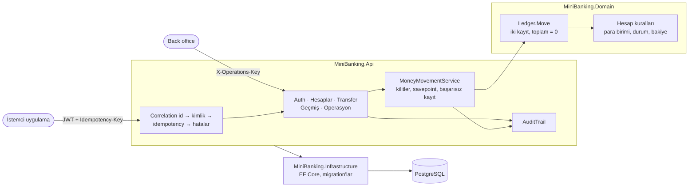
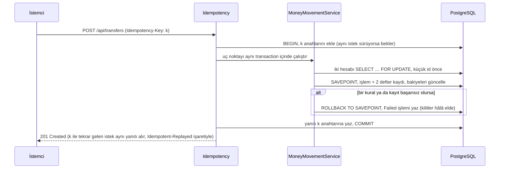

# Mini Banking API

[English](README.md) · **Türkçe**

Tek bir söz üzerine kurulu bir bankacılık API'si: para yoktan var olmaz, kaybolmaz ve iki kez hareket etmez. Ne istek tekrarlandığında, ne aynı anda gelen isteklerde, ne de veritabanı işin ortasında hata verdiğinde.

[](https://github.com/Beratoguzhan620/mini-banking-api/actions/workflows/ci.yml)


## Deneme

```bash
docker compose up --build
```

Etkileşimli API belgesi için http://localhost:8080/scalar adresini aç. Akışın tamamını terminalden görmek için (`curl` ve `jq` gerekir):

```bash
OPERATIONS_API_KEY=local-ops docker compose up --build -d
OPS_KEY=local-ops ./scripts/demo.sh
```

Betik iki müşteri kaydeder, aralarında para gönderir, bir isteği aynı idempotency anahtarıyla tekrarlar, tek bir hesaba aynı anda 100 transfer gönderir ve mutabakat raporuyla biter.

## Özellikler

- **Müşteriler:** JWT ile kayıt ve giriş. Parolalar PBKDF2 ile saklanır; bilinmeyen e-posta ile yanlış parola aynı yanıtı alır.
- **Hesaplar:**
  - Her hesabın tek bir para birimi var (TRY, USD, EUR); bir müşterinin birden çok hesabı olabilir.
  - `MB1234567890123456` biçiminde, Luhn kontrol haneli hesap numaraları. Yanlış yazılan alıcı numarası veritabanına gitmeden yakalanır.
  - Dondurma (para girer, çıkamaz), çözme ve kapatma (yalnızca bakiye sıfırken).
- **Para hareketleri:** simülasyon amaçlı para yatırma ve çekme; aynı para birimindeki herhangi bir hesap numarasına transfer. Yetersiz bakiye, dondurulmuş veya kapalı hesap ve farklı para birimi reddedilir; deneme `Failed` işlem olarak saklanır.
- **Çift taraflı defter:** her hareket toplamı sıfır olan iki kayıt yazar. Yatırma ve çekme, para birimi başına bir sistem hesabıyla dengelenir.
- **Idempotency:** yatırma, çekme ve transfer `Idempotency-Key` başlığı ister. Tekrar eden istek ilk yanıtı alır; aynı anahtar farklı bir istekle gelirse reddedilir.
- **Hesap geçmişi:** en yeni önce; tarih ve türe göre filtre; opak bir cursor ile sayfalama (keyset, `OFFSET` yok).
- **Denetim kaydı:** kayıtlar, girişler (başarısızlar dahil), hesap değişiklikleri ve tüm para hareketleri; işlemi yapan kişi ve isteğin correlation id'siyle. Tablo yalnızca ekleme kabul eder; bunu veritabanındaki bir trigger zorlar.
- **Operasyon uç noktaları:** mutabakat raporu (önbellekteki bakiyeler ile defterin karşılaştırması, para birimi başına pozisyonlar) ve denetim kaydı araması. Ayrı bir anahtarla korunur, yapılandırılmadıkça kapalıdır.
- **Gözlemlenebilirlik:** her yanıtta, hata mesajında ve log satırında bir correlation id; kişisel veriler ve gizli bilgiler loglarda maskelenir.

## Ekran görüntüleri

| API belgesi | Transfer uç noktası |
|---|---|
|  |  |
| **Idempotency başlığıyla para yatırma** | **Mutabakat raporu** |
|  |  |

## Teknolojiler

- ASP.NET Core 10 minimal API, ProblemDetails (RFC 9457), Scalar ile OpenAPI
- Entity Framework Core 10 ve PostgreSQL (Npgsql), snake_case adlandırma, migration'lar
- JWT bearer kimlik doğrulama, ASP.NET Core Identity parola hasher'ı
- Serilog ile yapılandırılmış loglar, correlation id ve maskeleme
- xUnit, Testcontainers (gerçek PostgreSQL), WebApplicationFactory
- GitHub Actions: uyarılar hata sayılır, birim ve entegrasyon testleri, bekleyen migration kontrolü, para hareketi yapan Docker Compose duman testi
- Docker / Docker Compose

## Mimari



Bir transferin adımları:



## Tasarım kararları

- **Para, kuruş cinsinden `long`.** Kayan nokta yok, yuvarlama kayması yok; SQL'deki toplamlar kesin. API en fazla iki ondalıklı sayılarla konuşur ve dönüşüm kenarda yapılır.
- **Kötümser kilit, id sırasıyla.** Transfer iki hesabı `SELECT … FOR UPDATE` ile kilitler; her zaman küçük id önce. A→B ve B→A aynı anda geldiğinde kilitleri aynı sırayla isterler, deadlock yerine sıraya girerler. Daha basit güncellemeleri (dondurma, kapatma) `xmin` eşzamanlılık belirteci korur.
- **Bakiye önbellekte, gerçek defterde.** Bakiye hesap satırında durduğu için okumalar hızlı; her defter kaydı kendinden sonraki bakiyeyi de saklar. Mutabakat uç noktası ve testler ikisinin her zaman tuttuğunu kontrol eder. Negatif müşteri bakiyesini ayrıca veritabanındaki bir check constraint reddeder.
- **Sistem hesaplarının önbellekte bakiyesi yok.** Her para yatırma işlemi o para biriminin sistem hesabına dokunur; satırını güncellemek onu veritabanının en sıcak satırı yapardı. Pozisyonu bunun yerine defter kayıtlarından hesaplanır.
- **Idempotency anahtarı ve para birlikte commit edilir.** Anahtar satırı, parayı hareket ettiren aynı veritabanı transaction'ının başında eklenir. Aynı anda gelen aynı istek bu satırda bekler, sonra saklanan yanıtı alır. Bu yüzden bir çökme ne anahtarsız para hareketi ne de parasız anahtar bırakabilir. Anahtarı yalnızca reddedilen istekler (400, 401, 404) geri verir.
- **Başarısız denemeler saklanır, aynı kilitler altında.** Reddedilen transfer bir savepoint'e geri döner ve `Failed` işlemi aynı transaction içinde yazar. İlk sürüm bu kaydı tam geri almadan sonra yazıyordu; eşzamanlılık testleri bunun kilitleri farklı sırayla aldığını ve yük altında deadlock yaptığını yakaladı.
- **Yasak yerine "bulunamadı".** Başkasının hesabı 404 döner; hesap id'leri yoklanamaz.
- **Denetim kaydı bir kanıttır.** Kayıtlar, anlattıkları değişiklikle aynı iş biriminde yazılır; yabancı anahtarları yoktur (bahsettikleri satırlardan uzun yaşarlar) ve bir trigger her `UPDATE`, `DELETE` ve `TRUNCATE` isteğini reddeder.
- **Operasyon kendi anahtarıyla.** Mutabakat ve denetim araması müşterilere ait değil. Ayrı bir anahtar kullanırlar, anahtar sabit sürede karşılaştırılır ve anahtar yapılandırılmamışsa uç noktalar 404 döner.

## Komutlar

| Komut | Ne yapar |
|---|---|
| `docker compose up --build` | API ve PostgreSQL, http://localhost:8080 |
| `./scripts/demo.sh` | Çalışan bir örnek üzerinde rehberli tur (`OPS_KEY` mutabakatı ekler) |
| `dotnet test` | Birim ve entegrasyon testleri (Testcontainers için Docker gerekir) |
| `dotnet run --project src/MiniBanking.Api` | Yerelde çalıştırma (aşağıdaki ayarlarla) |
| `dotnet ef migrations add <Ad> --project src/MiniBanking.Infrastructure --startup-project src/MiniBanking.Api --output-dir Persistence/Migrations` | Migration ekleme |

Yerelde çalıştırmak için ayarlar; repoya girmezler:

```bash
dotnet user-secrets --project src/MiniBanking.Api set "ConnectionStrings:Banking" "Host=localhost;Database=mini_banking;Username=…;Password=…"
dotnet user-secrets --project src/MiniBanking.Api set "Jwt:SigningKey" "<en az 32 karakter>"
dotnet user-secrets --project src/MiniBanking.Api set "Operations:ApiKey" "<isteğe bağlı>"
```

## Testler

98 test: alan kuralları için 28 birim testi ve gerçek API'yi Testcontainers'taki PostgreSQL'e karşı çalıştıran 70 entegrasyon testi.

- **Eşzamanlılık:** tek hesaptan 100 paralel transfer (bakiyenin izin verdiği kadarı başarılı olur, bakiye hiç eksiye düşmez); ters yönlerde deadlock olmadan 100 transfer; tek hesapta yarışan yatırma, çekme ve transferler.
- **Idempotency:** tekrar oynatma, farklı gövdeyle yeniden kullanılan anahtar, müşteriye özel anahtarlar, bakiye değiştikten sonra tekrar oynatılan iş kuralı hatası, aynı anda gelen 20 aynı isteğin parayı tek kez hareket ettirmesi.
- **Hata:** transferin ortasına enjekte edilen veritabanı hatası her şeyi geri alır ve bir `Failed` kaydı bırakır.
- **Defter değişmezleri:** her senaryodan sonra her işlemin kayıtları toplamda sıfır, her önbellekteki bakiye kendi defterine eşit.
- **Güvenlik:** her uç noktada sahiplik kontrolü, değiştirilmiş token'lar, operasyon anahtarı, yalnızca ekleme kabul eden denetim kaydı, loglarda ve denetim kaydında parola ya da tam e-posta olmaması.

## Yol haritası ve bilinen eksikler

- Eski idempotency anahtarlarının temizlenmesi ([background-jobs](https://github.com/Beratoguzhan620/background-jobs) projesi için bir iş).
- Günlük para çekme limitleri ve bekleyen ödemeler için bloke/çözme akışı.
- İşlem olaylarının outbox üzerinden [notification-service](https://github.com/Beratoguzhan620/notification-service)'e gönderilmesi.
- Sonuçları yayımlanmış bir k6 yük testi.
- Refresh token'lar; şu an access token bir saat sonra süresi dolarak geçersiz olur.

## Lisans

[MIT](LICENSE) · Berat Oğuzhan Turğut · [GitHub](https://github.com/Beratoguzhan620)
